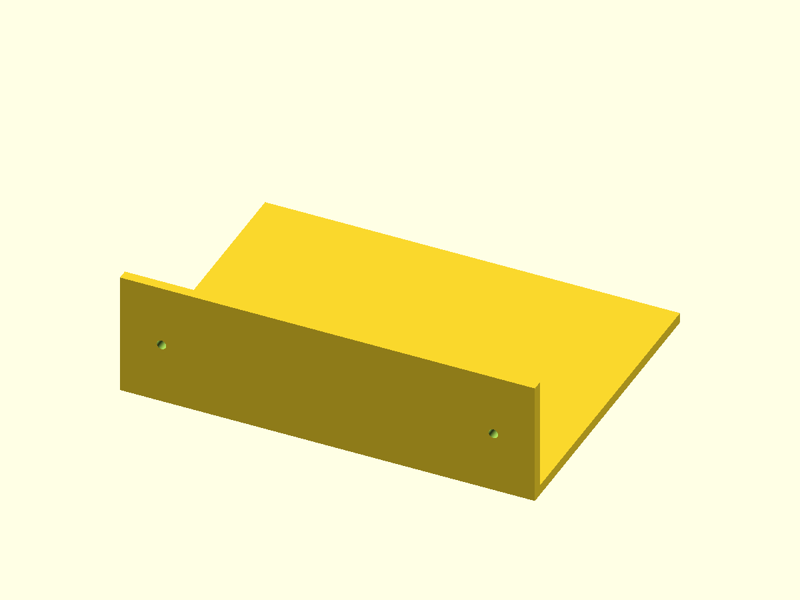

# PolyForge · 本地 CAD 集成派生版

基于 [rx290/polyforge](https://github.com/rx290/polyforge) 的 Windows / 本地工具链适配，保留 Muhammad Asad Waseem 的原 MIT 许可和作者归属。它把模板范围内的自然语言要求转换为参数化 CAD 源码，可调用本机 OpenSCAD、FreeCAD 或 Blender 导出模型；**不是从零原创的 CAD 内核**。



[旋转查看真实示例模型](https://yangwei251003.github.io/polyforge-local/) · [上游说明](docs/UPSTREAM_README.md) · [增量与验证](docs/local-validation.md)

## 最简运行

Python 3.10+，本轮使用3.12。模板/匹配/CLI核心只有标准库，不要求模型账号或API Key。

```sh
python -m venv .venv
.venv/Scripts/python -m pip install -e .
.venv/Scripts/python -m polyforge.cli list-templates
.venv/Scripts/python -m polyforge.cli design "a wall shelf 200x150x60mm with 2 M4 holes" --out shelf.scad
```

macOS/Linux将上述Python路径换为 .venv/bin/python。默认模板覆盖盒体、壁架、角码、理线、支柱安装板、花瓶等；自由文字不是任意形状建模保证。输出文件的父目录应先创建。

安装对应CAD程序并加入PATH后：

```sh
python -m polyforge.cli export shelf.scad
python -m polyforge.cli inspect output/shelf.stl
```

OpenSCAD负责SCAD编译与多角度PNG；FreeCAD可生成STL/STEP，Blender负责其自身Python几何导出。使用 --backend freecad / blender 生成相应宏，具体参数见 --help。程序、SDK、模型服务和Python环境不随仓库分发。

本机FreeCAD1.1.3控制台在初始化时退出；通过其自带Python直接导入同一FreeCAD/Part库已完成真实导出和尺寸/水密性回归。可按[FreeCAD官方嵌入方式](https://github.com/FreeCAD/FreeCAD-documentation/blob/main/wiki/Embedding_FreeCAD.md)配置兼容解释器，例如 Windows PowerShell 中设置 FREECAD_BIN 为 FreeCAD安装目录/bin/python.exe。此覆盖项原本已支持；没有把控制台启动故障说成已修复。

## 可选能力与运行限制

- --engine templates 默认离线；--engine llm 需要使用者已有的本地 Ollama 服务/模型，本轮未推理真实模型、未拉取大模型。
- repair功能需trimesh；摄影测量需COLMAP/OpenMVS；本轮没有安装或验证缺失的重建工具。
- GUI源代码保留；桌面交互、打印机实物尺寸/强度和制造安全未验收。几何检查不能替代实际打印/装配验证。
- .claude/skills/polyforge 是上游自带的可复用接口资料，不把第三方Skill冒称原创；AGENTS文档也保留原归属。

## 本轮真实验证

现有138项完整工具链测试首次123通过、6跳过、9失败。Windows日志读取修补后，9项失败在真实Blender5.2 / FreeCAD1.1.3库中全部复测通过；另外4项原生UTF-8/非法字节回归通过。结合各次结果为136个已通过案例、6个未执行案例，**不是单次全量全绿的宣称**。普通无外部CAD路径运行：104通过、38因缺少可选工具/服务跳过。

跳过的真实Ollama/模型、NVIDIA和摄影测量依赖等不算通过。本轮另外按CLI生成并用OpenSCAD导出壁架：796三角面，200×150×60mm，0退化面，边计数水密；站点展示的是这份实际STL，不能在浏览器重新运行CAD后端。

```sh
python -m pip install pytest trimesh
python -m pytest -q
```

在有CAD程序的环境中将其加入当前进程PATH；FreeCAD覆盖项应指向可用的CLI或兼容Python。完整证据边界见 docs/local-validation.md。

## 源码、许可与计划

src/polyforge为CLI、模板、几何与GUI源码；tests保留上游合成36张轨道视角夹具和测试；examples/shelf.scad与site/shelf.stl为本轮真实生成示例；site只是静态模型预览。上游gallery有对应生成脚本，原许可和署名保留。

原本机在7个源码文件增加路径/后端/GUI等适配，本轮保留这些增量，并修补Windows原生UTF-8日志、测试输出捕获，以及FreeCAD覆盖项的回归测试。后续完善跨平台工具发现、摄影测量/本地模型验收与SDK兼容。根MIT与上游作者不变；没有商业CAD库、DLL、用户照片、密钥或本地配置。

该派生版持续开发，完整能力仍依赖本机工具链，当前不可据此删除原安装目录。更新见 CHANGELOG.md。
